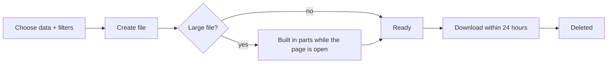
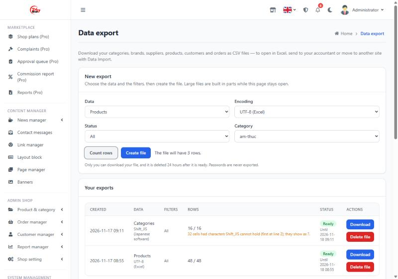
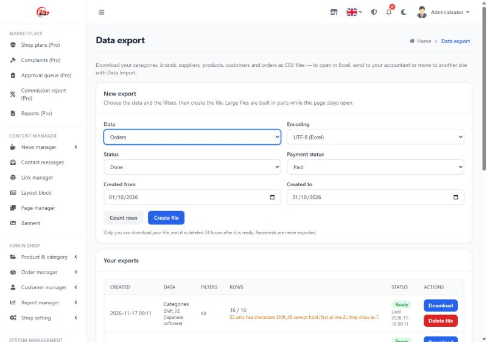
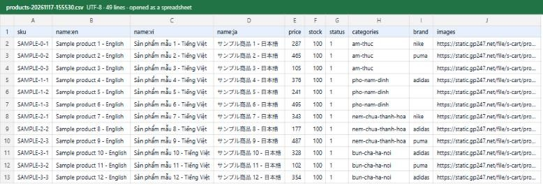

> 🌐 **Language:** [🇻🇳 Tiếng Việt](./readme_vi.md) · 🇬🇧 English (current) · [🇯🇵 日本語](./readme_ja.md)

# Data Export for GP247 / S-Cart

A free plugin that takes your shop data out as CSV files: **categories, brands, suppliers, products, customers, orders**.
The files open directly in Excel, can go to your accountant, and import into another GP247 site with the **Data Import** plugin without mapping a column.

## Requirements

| Item | Requirement |
|---|---|
| GP247 core | 3.12 or newer |
| gp247/shop | installed (`php artisan gp247:shop-install`) |
| Server | runs on shared hosting: **no** cron, queue or command line needed |
| Shift_JIS encoding | needs PHP `mbstring` (available on most hosts); without it only UTF-8 is offered |

## How to use

1. Open **System → Data export**.
2. Choose the **data**, the **filters** (creation date, status, payment status, category, store) and the **encoding**.
3. Click **Count rows** to see how many rows the file will have, then **Create file**.
4. A small file is ready at once. A large file is built in parts while the page stays open (rows written are shown); close the page and it continues when you open it again.
5. Click **Download**. The file is deleted after **24 hours**; click **Delete file** to remove it earlier.

On a server with a command line (VPS) a run can be built in one go: `php artisan data-export:run <run id>` (the id is shown on the screen).

## Screenshots

Choose the data, filter by category and see the row count first; the list of files shows how long each can be downloaded and warns when Shift_JIS had to replace characters:

Orders can be filtered by status, payment status and creation dates:

The file opened in a spreadsheet: one column per language, categories and brands by alias, images as full URLs:

## Encoding

| Choice | Use it when |
|---|---|
| **UTF-8 (Excel)** — default | Opening in Excel, Google Sheets or LibreOffice; keeps Vietnamese, Japanese and every other language |
| **Shift_JIS** | Japanese accounting software or older Excel that only reads Shift_JIS. Characters Shift_JIS cannot hold (Vietnamese accents, emoji…) show as `?` and the screen tells how many cells changed. Do not use Shift_JIS files to move a site |

## Cells that start with `'`

A text cell that starts with `=`, `+`, `-` or `@` gets a leading `'` so a spreadsheet never runs it as a formula (this protects whoever opens the file). Numbers such as `-5` stay as they are.
Data Import removes that `'` when the file is imported again.

## Columns of each kind

Texts per language have one column for every active language, named `name:en`, `name:vi`…

| Data | Columns |
|---|---|
| Categories | `key` (= alias), `alias`, `parent` (alias of the parent), `name`, `keyword`, `description` (per language), `image`, `sort`, `status`, `top` |
| Brands | `key` (= alias), `name`, `alias`, `image`, `url`, `sort`, `status` |
| Suppliers | `key` (= alias), `name`, `alias`, `image`, `url`, `email`, `phone`, `address`, `sort` |
| Products | `sku`, `alias`, `name`, `keyword`, `description`, `content` (per language), `price`, `cost`, `stock`, `minimum`, `weight`, `status`, `sort`, `tags`, `categories` (aliases separated by `\|`), `brand`, `supplier` (aliases), `images` (full URLs, main image first, separated by `\|`) |
| Customers | `email`, `first_name`, `last_name`, `first_name_kana`, `last_name_kana`, `phone`, `company`, `sex`, `birthday`, `group`, `country`, `postcode`, `city`, `district`, `ward`, `address1`, `address2`, `address3`, `status` |
| Orders | `key` (order id), `customer` (e-mail of the buyer's account), `email`, `first_name`, `last_name`, `phone`, `company`, `address1`–`address3`, `city`, `district`, `ward`, `country`, `postcode`, `currency`, `exchange_rate`, `payment_method`, `shipping_method`, `comment`, `subtotal`, `shipping`, `tax`, `discount`, `other_fee`, `total`, `received`, `status`, `shipping_status`, `payment_status` (status names), `created_at`, `line_sku`, `line_name`, `line_price`, `line_qty`, `line_total`, `line_tax`, `line_tax_rate`, `line_discount` |

- Orders: **one row per product line**; the order details are on the first row of the order only.
- Products: single products only (no bundles or groups). Rows follow the internal id, not the creation date.
- **Never exported**: passwords (hashed or not), tokens, two-factor codes, secret settings.

## Moving to another GP247 site

1. On the old site export, in this order: categories → brands → suppliers → products → customers → orders (use **UTF-8**).
2. On the new site install **Data Import** and import the files **in the same order**. Columns match on their own; for orders you only pick the matching statuses.
3. Product images are downloaded from the old site by URL — the old site must still be reachable during the import.

Notes:
- Importing categories, brands, suppliers or customers back **into the site they came from** recognises them (nothing is duplicated). Products with images may show as "Update" because the images are downloaded again.
- **Do not** import an orders file back into the site it came from — the orders would be created twice.
- Customers on the new site use "Forgot password" to set a new password.

## Permissions

| Permission | Allows |
|---|---|
| Data export — open the screen | Open the Data export screen |
| Data export — catalog | Export categories, brands, suppliers, products |
| Data export — customers | Export customers |
| Data export — orders | Export orders |

By default only **Administrator** has them. You can let an accountant export orders without exporting the customer list.
On a multi-store site only admins at the **root store** use this screen (it has a store filter).

Every file created and downloaded is written to the **operation log** (who, data, filters, rows — never the content of the file).

## Uninstall

Uninstalling deletes every export file left on the server, the menu entry and the plugin's permissions. The list of runs (which holds no customer data) is kept.

## License

MIT — free for every GP247 / S-Cart site.
