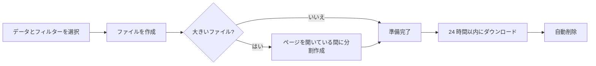
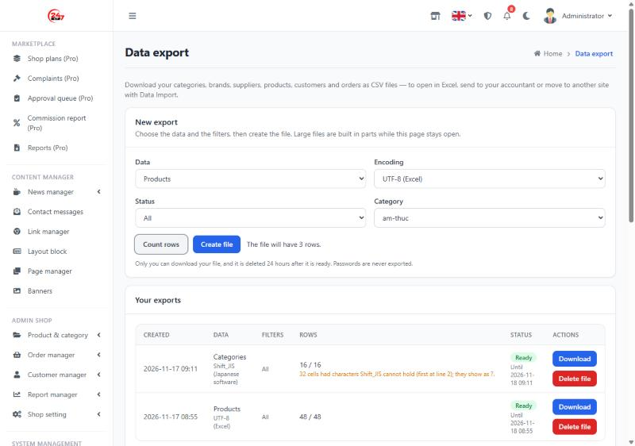
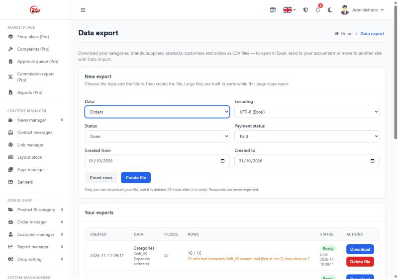
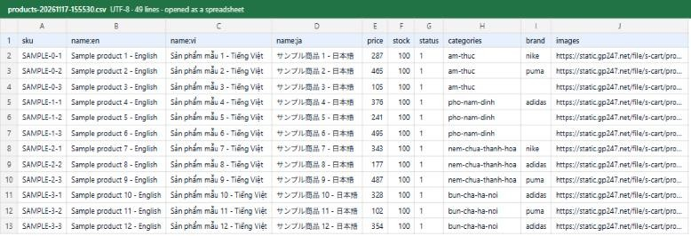

> 🌐 **言語:** [🇻🇳 Tiếng Việt](./readme_vi.md) · [🇬🇧 English](./readme.md) · 🇯🇵 日本語（現在）

# GP247 / S-Cart 用データエクスポート（Data Export）

ショップのデータを CSV ファイルで取り出す無料プラグインです。対象は **カテゴリ、ブランド、仕入先、商品、顧客、注文** です。
ファイルは Excel でそのまま開け、会計担当に渡すことができ、**データインポート（Data Import）** プラグインで列の対応付けなしに別の GP247 サイトへ取り込めます。

## 動作要件

| 項目 | 要件 |
|---|---|
| GP247 core | 3.12 以上 |
| gp247/shop | インストール済み（`php artisan gp247:shop-install`） |
| サーバー | 共用サーバーで動作します。cron、キュー、コマンドラインは **不要** です |
| Shift_JIS | PHP の `mbstring` が必要です（多くのサーバーで利用可能）。ない場合は UTF-8 のみ表示されます |

## 使い方

1. **システム → データエクスポート** を開きます。
2. **データ**、**フィルター**（作成日、ステータス、支払いステータス、カテゴリ、ストア）、**文字コード** を選びます。
3. **行数を数える** で行数を確認し、**ファイルを作成** をクリックします。
4. 小さいファイルはすぐに準備完了になります。大きいファイルはページを開いている間に分割して作成されます（書き込んだ行数を表示）。ページを閉じても、再び開くと続きから作成します。
5. **ダウンロード** をクリックします。ファイルは **24 時間後** に削除されます。早く消すには **ファイルを削除** をクリックします。

コマンドラインが使えるサーバー（VPS）では一度に作成できます: `php artisan data-export:run <実行 ID>`（ID は画面に表示）。

## スクリーンショット

データを選び、カテゴリで絞り込み、行数を先に確認できます。エクスポート一覧にはダウンロード期限と、Shift_JIS で文字を置き換えた場合の警告が表示されます:

注文はステータス、支払いステータス、作成日の範囲で絞り込めます:

表計算ソフトで開いたファイル: 言語ごとに 1 列、カテゴリとブランドは alias、画像は完全な URL です:

## 文字コード

| 選択肢 | 使う場面 |
|---|---|
| **UTF-8（Excel）** — 既定 | Excel、Google スプレッドシート、LibreOffice で開く場合。日本語、ベトナム語などすべての言語をそのまま保持します |
| **Shift_JIS** | Shift_JIS しか読めない会計ソフトや古い Excel 向け。Shift_JIS で表せない文字（ベトナム語の声調記号、絵文字など）は `?` になり、置き換えたセル数を画面に表示します。サイト移行には使わないでください |

## `'` で始まるセル

`=`、`+`、`-`、`@` で始まる文字のセルには先頭に `'` を付け、表計算ソフトが数式として実行しないようにしています（ファイルを開く人を守るため）。`-5` のような数値はそのままです。
データインポートで取り込むと、この `'` は自動で取り除かれます。

## データごとの列

言語ごとのテキストは、有効な言語ごとに `name:ja`、`name:en` のような列になります。

| データ | 列 |
|---|---|
| カテゴリ | `key`（= alias）、`alias`、`parent`（親カテゴリの alias）、`name`、`keyword`、`description`（言語ごと）、`image`、`sort`、`status`、`top` |
| ブランド | `key`（= alias）、`name`、`alias`、`image`、`url`、`sort`、`status` |
| 仕入先 | `key`（= alias）、`name`、`alias`、`image`、`url`、`email`、`phone`、`address`、`sort` |
| 商品 | `sku`、`alias`、`name`、`keyword`、`description`、`content`（言語ごと）、`price`、`cost`、`stock`、`minimum`、`weight`、`status`、`sort`、`tags`、`categories`（alias を `\|` 区切り）、`brand`、`supplier`（alias）、`images`（完全な URL、メイン画像が先頭、`\|` 区切り） |
| 顧客 | `email`、`first_name`、`last_name`、`first_name_kana`、`last_name_kana`、`phone`、`company`、`sex`、`birthday`、`group`、`country`、`postcode`、`city`、`district`、`ward`、`address1`、`address2`、`address3`、`status` |
| 注文 | `key`（注文 ID）、`customer`（購入者アカウントのメール）、`email`、`first_name`、`last_name`、`phone`、`company`、`address1`〜`address3`、`city`、`district`、`ward`、`country`、`postcode`、`currency`、`exchange_rate`、`payment_method`、`shipping_method`、`comment`、`subtotal`、`shipping`、`tax`、`discount`、`other_fee`、`total`、`received`、`status`、`shipping_status`、`payment_status`（ステータス名）、`created_at`、`line_sku`、`line_name`、`line_price`、`line_qty`、`line_total`、`line_tax`、`line_tax_rate`、`line_discount` |

- 注文: **商品明細 1 件につき 1 行** です。注文情報は注文の最初の行にだけ入ります。
- 商品: 単品のみ（セット商品・グループは含みません）。行の順序は内部 ID 順で、作成日順ではありません。
- **エクスポートしないもの**: パスワード（ハッシュ化されたものも含む）、トークン、二段階認証コード、秘密の設定値。

## 別の GP247 サイトへの移行

1. 旧サイトで次の順にエクスポートします: カテゴリ → ブランド → 仕入先 → 商品 → 顧客 → 注文（**UTF-8** を使用）。
2. 新サイトに **データインポート** をインストールし、**同じ順序** で取り込みます。列は自動で対応し、注文では対応するステータスを選ぶだけです。
3. 商品画像は旧サイトから URL でダウンロードされます。取り込み中は旧サイトにアクセスできる必要があります。

注意:
- カテゴリ・ブランド・仕入先・顧客を **エクスポート元のサイトに** 取り込み直すと既存データとして認識されます（重複しません）。画像のある商品は画像を再ダウンロードするため「更新」と表示されることがあります。
- 注文ファイルをエクスポート元のサイトに取り込み直さないでください。注文が二重に作成されます。
- 新サイトの顧客は「パスワードを忘れた」から新しいパスワードを設定します。

## 権限

| 権限 | 許可される操作 |
|---|---|
| Data export — open the screen | データエクスポート画面を開く |
| Data export — catalog | カテゴリ、ブランド、仕入先、商品のエクスポート |
| Data export — customers | 顧客のエクスポート |
| Data export — orders | 注文のエクスポート |

既定では **Administrator** のみが持っています。会計担当に、顧客一覧は渡さず注文のエクスポートだけを許可することもできます。
マルチストアのサイトでは、**ルートストア** の管理者だけがこの画面を使えます（ストアで絞り込めます）。

ファイルの作成とダウンロードはすべて **操作ログ** に記録されます（誰が、どのデータを、どのフィルターで、何行 — ファイルの中身は記録しません）。

## アンインストール

アンインストールすると、サーバーに残っているエクスポートファイル、メニュー項目、プラグインの権限を削除します。実行履歴（顧客データは含みません）は残ります。

## リリース履歴

バージョンと変更内容: [リリース履歴](Release-history/v1_ja.md)。

## ライセンス

MIT — すべての GP247 / S-Cart サイトで無料です。
