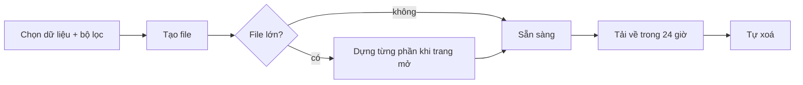
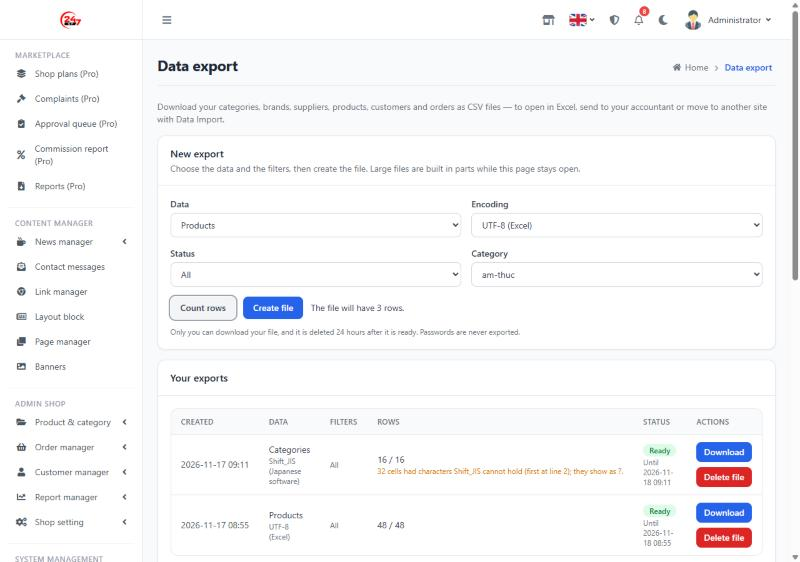
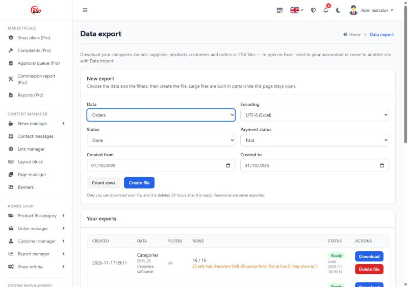
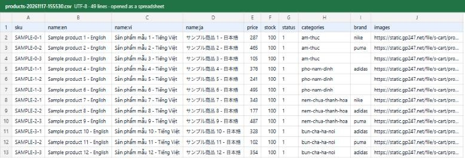

> 🌐 **Ngôn ngữ:** 🇻🇳 Tiếng Việt (hiện tại) · [🇬🇧 English](./readme.md) · [🇯🇵 日本語](./readme_ja.md)

# Xuất dữ liệu (Data Export) cho GP247 / S-Cart

Plugin miễn phí để lấy dữ liệu cửa hàng ra file CSV: **danh mục, thương hiệu, nhà cung cấp, sản phẩm, khách hàng, đơn hàng**.
File mở thẳng bằng Excel, gửi được cho kế toán, và nhập lại được vào một site GP247 khác bằng plugin **Nhập dữ liệu (Data Import)** mà không phải ghép cột.

## Yêu cầu

| Hạng mục | Yêu cầu |
|---|---|
| GP247 core | 3.12 trở lên |
| gp247/shop | đã cài (`php artisan gp247:shop-install`) |
| Máy chủ | chạy được trên shared host: **không cần** cron, queue hay quyền dòng lệnh |
| Bảng mã Shift_JIS | cần PHP `mbstring` (có sẵn trên hầu hết host); không có thì chỉ hiện UTF-8 |

## Cách dùng

1. Vào **Hệ thống → Xuất dữ liệu**.
2. Chọn **Dữ liệu**, các **bộ lọc** (ngày tạo, trạng thái, trạng thái thanh toán, danh mục, cửa hàng) và **Bảng mã**.
3. Bấm **Đếm số dòng** để biết trước file có bao nhiêu dòng, rồi **Tạo file**.
4. File nhỏ sẵn sàng ngay. File lớn được dựng từng phần trong lúc trang còn mở (có số dòng đã ghi); đóng trang thì mở lại sẽ chạy tiếp.
5. Bấm **Tải về**. File tự xoá sau **24 giờ**; bấm **Xoá file** để xoá sớm.

Máy chủ có dòng lệnh (VPS) có thể dựng hết một lần: `php artisan data-export:run <mã đợt>` (mã đợt lấy từ màn hình).

## Ảnh màn hình

Chọn dữ liệu, lọc theo danh mục và biết trước số dòng; danh sách file xuất có hạn tải và cảnh báo khi Shift_JIS phải thay ký tự:

Đơn hàng lọc được theo trạng thái, trạng thái thanh toán và khoảng ngày tạo:

File mở bằng bảng tính: mỗi ngôn ngữ một cột, danh mục / thương hiệu theo alias, ảnh là URL đầy đủ:

## Bảng mã

| Lựa chọn | Dùng khi |
|---|---|
| **UTF-8 (Excel)** — mặc định | Mở bằng Excel, Google Sheets, LibreOffice; giữ đúng chữ Việt, Nhật và mọi ngôn ngữ |
| **Shift_JIS** | Phần mềm kế toán / Excel cũ của Nhật chỉ đọc Shift_JIS. Ký tự Shift_JIS không chứa được (chữ Việt có dấu, emoji…) hiện là `?` và màn hình báo số ô bị thay. Không dùng file Shift_JIS để chuyển site |

## Ô bắt đầu bằng dấu `'`

Ô chữ bắt đầu bằng `=`, `+`, `-` hoặc `@` được thêm `'` ở đầu, để bảng tính không chạy nội dung đó như công thức (bảo vệ máy người mở file). Số như `-5` giữ nguyên.
Plugin Nhập dữ liệu tự bỏ dấu `'` này khi nhập lại.

## Cột của từng loại

Văn bản theo ngôn ngữ có một cột cho mỗi ngôn ngữ đang bật, dạng `name:vi`, `name:en`…

| Dữ liệu | Cột |
|---|---|
| Danh mục | `key` (= alias), `alias`, `parent` (alias của danh mục cha), `name`, `keyword`, `description` (theo ngôn ngữ), `image`, `sort`, `status`, `top` |
| Thương hiệu | `key` (= alias), `name`, `alias`, `image`, `url`, `sort`, `status` |
| Nhà cung cấp | `key` (= alias), `name`, `alias`, `image`, `url`, `email`, `phone`, `address`, `sort` |
| Sản phẩm | `sku`, `alias`, `name`, `keyword`, `description`, `content` (theo ngôn ngữ), `price`, `cost`, `stock`, `minimum`, `weight`, `status`, `sort`, `tags`, `categories` (alias, ngăn bằng `\|`), `brand`, `supplier` (alias), `images` (URL đầy đủ, ảnh chính trước, ngăn bằng `\|`) |
| Khách hàng | `email`, `first_name`, `last_name`, `first_name_kana`, `last_name_kana`, `phone`, `company`, `sex`, `birthday`, `group`, `country`, `postcode`, `city`, `district`, `ward`, `address1`, `address2`, `address3`, `status` |
| Đơn hàng | `key` (mã đơn), `customer` (email tài khoản của người mua), `email`, `first_name`, `last_name`, `phone`, `company`, `address1`–`address3`, `city`, `district`, `ward`, `country`, `postcode`, `currency`, `exchange_rate`, `payment_method`, `shipping_method`, `comment`, `subtotal`, `shipping`, `tax`, `discount`, `other_fee`, `total`, `received`, `status`, `shipping_status`, `payment_status` (tên trạng thái), `created_at`, `line_sku`, `line_name`, `line_price`, `line_qty`, `line_total`, `line_tax`, `line_tax_rate`, `line_discount` |

- Đơn hàng: **mỗi dòng sản phẩm một dòng**; thông tin đơn chỉ nằm ở dòng đầu của đơn.
- Sản phẩm: chỉ xuất sản phẩm đơn (không gồm combo / nhóm). Thứ tự dòng theo mã nội bộ, không theo ngày tạo.
- **Không bao giờ xuất**: mật khẩu (kể cả dạng mã hoá), token, mã xác thực 2 lớp, cấu hình bí mật.

## Chuyển sang site GP247 khác

1. Ở site cũ, xuất lần lượt: danh mục → thương hiệu → nhà cung cấp → sản phẩm → khách hàng → đơn hàng (dùng **UTF-8**).
2. Ở site mới, cài **Nhập dữ liệu** và nhập các file **đúng thứ tự trên**. Cột tự khớp; với đơn hàng chỉ cần chọn trạng thái tương ứng.
3. Ảnh sản phẩm được tải về từ site cũ theo URL — site cũ phải còn truy cập được lúc nhập.

Lưu ý:
- Nhập lại danh mục / thương hiệu / nhà cung cấp / khách hàng **vào chính site đã xuất** sẽ được nhận ra (không tạo trùng). Sản phẩm có ảnh có thể hiện là "Sửa" vì ảnh được tải lại.
- **Không** nhập lại file đơn hàng vào chính site đã xuất — đơn sẽ bị tạo trùng.
- Khách hàng ở site mới cần dùng "Quên mật khẩu" để đặt lại mật khẩu.

## Quyền

| Quyền | Cho phép |
|---|---|
| Data export — open the screen | Mở màn Xuất dữ liệu |
| Data export — catalog | Xuất danh mục, thương hiệu, nhà cung cấp, sản phẩm |
| Data export — customers | Xuất khách hàng |
| Data export — orders | Xuất đơn hàng |

Mặc định chỉ **Administrator** có quyền. Có thể giao quyền xuất đơn cho kế toán mà không cho xuất danh sách khách.
Trên site nhiều cửa hàng, chỉ quản trị ở **cửa hàng gốc** dùng được màn này (có bộ lọc theo cửa hàng).

Mọi lần tạo và tải file đều được ghi vào **nhật ký thao tác** (ai, loại dữ liệu, bộ lọc, số dòng — không ghi nội dung file).

## Gỡ cài đặt

Gỡ plugin xoá toàn bộ file xuất còn trên máy chủ, mục menu và các quyền của plugin. Danh sách đợt xuất (không chứa dữ liệu khách) được giữ lại.

## Lịch sử phát hành

Các phiên bản và thay đổi: [Lịch sử phát hành](Release-history/v1_vi.md).

## Giấy phép

MIT — miễn phí cho mọi site GP247 / S-Cart.
